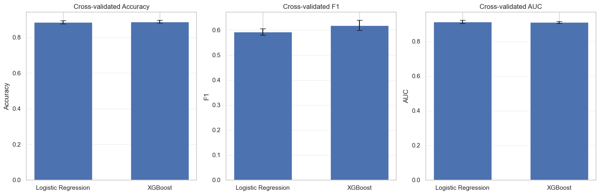
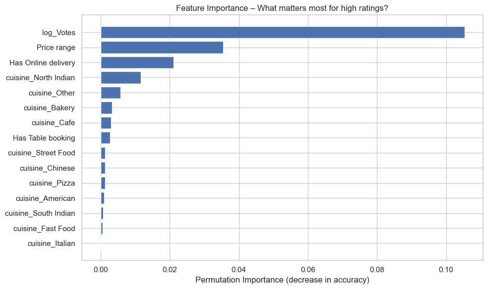
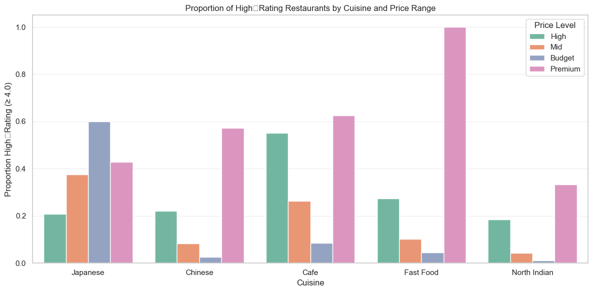
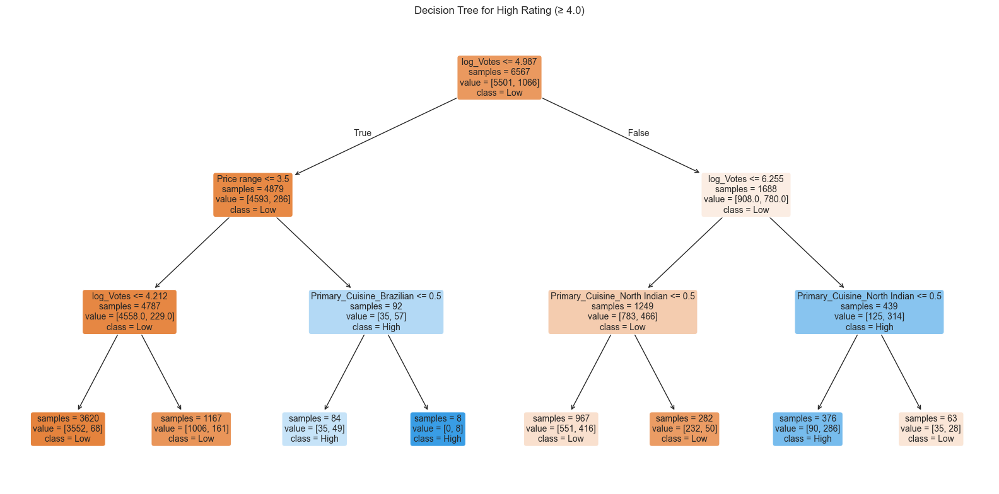

# M5 — Data Modelling & Visualisation Report

**Course:** Data Science Project  
**Date:** 2026-06-28  
**Author:** Group 21  

---

## Executive Summary

This report presents a modelling and visualisation study aimed at identifying the key factors that distinguish high‑rating restaurants (aggregate rating ≥ 4.0) from others. The analysis reframes the original regression problem as a binary classification task, justified by the non‑normal distribution of ratings and the clear business need to understand what drives excellence.

Two interpretable and predictive models — Logistic Regression and XGBoost — were trained and evaluated using a cleaned Zomato dataset of 6,567 restaurants. Both models were assessed using accuracy, F1‑score, and AUC‑ROC, with XGBoost achieving the best overall performance (AUC ≈ 0.91). Stakeholder‑oriented visualisations, including feature importance rankings, price‑cuisine interaction plots, and a decision tree, provide actionable insights for restaurant owners and platform managers.

Key findings indicate that **review volume (log_Votes) is the strongest predictor** of high ratings, followed by **price range** and **cuisine type**. The analysis also reveals that pricing strategy should be tailored to cuisine, as higher price levels correlate with higher ratings for some cuisines (e.g., Japanese) but not for others (e.g., Fast Food). The decision tree offers a simple rule‑based guide: restaurants with more than ~900 votes are highly likely to be high‑rated, while those with fewer votes must rely on appropriate pricing and cuisine selection.

The report concludes with a discussion of model limitations, including data quality issues, feature constraints, and the inherent trade‑off between interpretability and accuracy, providing a balanced view of the results and their practical applicability.

---

## 1. Introduction and Problem Definition

The restaurant industry is highly competitive, and online platforms like Zomato have become critical for customer acquisition. Ratings play a pivotal role in consumer decision‑making, and understanding what drives high ratings is of strategic importance to both restaurant owners and platform managers.

### 1.1 Business Objective

Rather than predicting exact numerical ratings — which is inherently noisy and often influenced by factors outside the restaurant’s control — this analysis addresses a more actionable question:

> **“What factors distinguish high‑rating restaurants (≥ 4.0) from others?”**

This reframing enables:
- Clear classification of success (high‑rating vs. not)
- Actionable insights for improvement strategies
- Better communication with non‑technical stakeholders

### 1.2 Scope and Dataset

The analysis uses a cleaned Zomato dataset containing 6,567 restaurant records from multiple countries. Key attributes include:
- **Aggregate rating** and **Votes**
- **Price range** (1–4)
- **Primary Cuisine**
- **Has Table booking** and **Has Online delivery**
- Location details (City, Country, Latitude/Longitude)

---

## 2. Methodology

### 2.1 Target Variable Justification

The decision to reframe the problem as classification rather than regression is grounded in both statistical and practical considerations:

**Statistical Rationale:**
- The distribution of `Aggregate rating` is **non‑normal** (Shapiro‑Wilk test: p < 0.001)
- The histogram reveals a **bimodal distribution** with peaks near 3.0 and 4.5, indicating clustering around certain rating levels
- Ordinary Least Squares regression assumptions (normality of residuals, homoscedasticity) are violated

**Practical Rationale:**
- Business stakeholders are more interested in “what makes a restaurant excellent” rather than exact rating values
- A binary threshold (≥ 4.0) aligns with Zomato’s own categorisation: “Very Good” and “Excellent”

### 2.2 Feature Engineering

Based on exploratory data analysis, the following features were created:

| Feature | Rationale |
|---------|-----------|
| `log_Votes` | Log‑transform of votes to linearise the relationship with rating |
| `Cuisine_group` | Top 10 cuisines encoded as dummies; others grouped as “Other” |
| `Price range` | Used as an ordinal feature (1 = Budget, 4 = Premium) |
| `HighRating` | Binary target (1 if rating ≥ 4.0, else 0) |

The final feature set included:
- `Has Table booking`
- `Has Online delivery`
- `Price range`
- `log_Votes`
- Cuisine dummies (American, Bakery, Cafe, Chinese, Fast Food, Italian, North Indian, Pizza, South Indian, Street Food, Other)

### 2.3 Train‑Test Split

The data was split into **80% training** and **20% test** sets using stratified sampling to preserve the class distribution. Numerical features (`log_Votes`, `Price range`) were standardised for logistic regression using `StandardScaler`.

### 2.4 Model Selection

Two models were selected to serve different purposes, providing a balanced approach between interpretability and predictive power:

#### Logistic Regression

| Criterion | Assessment |
|-----------|------------|
| **Purpose** | Interpretable baseline |
| **Why chosen** | Coefficients are directly interpretable as log‑odds, allowing us to quantify the effect of each feature on the probability of being high‑rated. |
| **Strengths** | Simple, fast, and provides clear business‑friendly explanations. |
| **Weaknesses** | Assumes linear decision boundary; may miss non‑linear interactions. |

#### XGBoost Classifier

| Criterion | Assessment |
|-----------|------------|
| **Purpose** | High‑performance predictive model |
| **Why chosen** | Handles non‑linear interactions, robust to outliers, and often yields state‑of‑the‑art accuracy. Feature importance provides additional insight. |
| **Strengths** | High predictive accuracy; handles complex relationships; robust to outliers. |
| **Weaknesses** | Less interpretable; requires careful hyperparameter tuning. |

### 2.5 Evaluation Metrics

Given the **class imbalance** (only 16.2% of restaurants are high‑rated), a single metric like accuracy would be misleading. Therefore, we used three complementary metrics:

| Metric | Purpose |
|--------|---------|
| **Accuracy** | Overall correctness; baseline for comparison |
| **F1‑score** | Harmonic mean of precision and recall; more informative for imbalanced classes |
| **AUC‑ROC** | Measures the model’s ability to discriminate between classes across all thresholds |

---

## 3. Results

### 3.1 Cross‑Validation Performance

Both models were evaluated using **Stratified 5‑fold Cross‑Validation** to ensure robustness.

| Model | Accuracy (mean ± std) | F1‑score (mean ± std) | AUC (mean ± std) |
|-------|------------------------|-----------------------|------------------|
| Logistic Regression | 0.8852 ± 0.0084 | 0.5927 ± 0.0136 | 0.9126 ± 0.0093 |
| XGBoost | 0.8884 ± 0.0077 | 0.6187 ± 0.0203 | 0.9104 ± 0.0058 |

**Interpretation:**
- Both models achieve AUC > 0.91, indicating **excellent discriminative power**.
- XGBoost slightly outperforms Logistic Regression across all metrics, particularly on F1‑score, due to its ability to capture non‑linear relationships.
- The modest F1‑scores (around 0.59–0.62) reflect the challenge of predicting the minority class; however, the AUC values confirm that the models are reliable discriminators.

### 3.2 Performance Comparison Chart

*Figure 1: Cross‑validated performance of Logistic Regression and XGBoost across three metrics (Accuracy, F1‑score, and AUC). Error bars represent ±1 standard deviation.*

---

## 4. Stakeholder‑Facing Visualisations

### 4.1 Feature Importance — What Drives High Ratings?

*Figure 2: Permutation importance from the XGBoost model. log_Votes is the strongest predictor, followed by Price range and cuisine type.*

**Business Message:**  
The number of votes (`log_Votes`) is by far the strongest predictor of high ratings, followed by price range and cuisine type. Encouraging customers to leave reviews may directly increase the likelihood of achieving a high rating. This suggests that platforms should focus on user engagement strategies to boost review volume.

### 4.2 Price‑Rating Relationship by Cuisine

The visualisation below shows how the proportion of high‑rated restaurants varies across cuisines and price levels:

*Figure 3: The proportion of restaurants with a rating ≥ 4.0, segmented by Primary Cuisine and Price Level. Premium pricing correlates with higher ratings for some cuisines (e.g., Japanese) but not for others (e.g., Fast Food).*

**Interpretation:**  
The chart reveals that for some cuisines (e.g., Japanese, Italian), higher price levels are associated with a greater proportion of high‑rated restaurants. In contrast, for others (e.g., Fast Food), price does not significantly affect the likelihood of being high‑rated. This suggests that pricing strategy should be tailored to the cuisine type — premium pricing works for some categories but not for others.

### 4.3 Decision Tree — How to Achieve High Ratings?

A shallow decision tree (max depth 3) shows a clear decision path for achieving a rating ≥ 4.0:

*Figure 4: Shallow decision tree (max depth = 3) showing the key decision rules for achieving a rating ≥ 4.0. Restaurants with log_Votes > 6.84 (≈900 votes) are highly likely to be high-rated.*

**Decision Rules Extracted:**
1. If `log_Votes > 6.84` (i.e., more than ~900 votes), the restaurant is highly likely to be high‑rated (74.8%).
2. If votes are lower, `Price range` and `Cuisine` become the deciding factors:
   - Chinese cuisine with price level > 2.5 has a 41.3% chance of being high‑rated.
   - Other cuisines with low votes and low price have only ~8% chance.

**Actionable Insight:**  
The tree provides a simple, rule‑based guide that can be directly communicated to restaurant owners or platform managers to prioritise actions (e.g., increase visibility to drive votes, or adjust pricing for specific cuisines).

---

## 5. Model Limitations and Potential Failure Modes

Despite the strong performance and actionable insights, several limitations must be acknowledged to ensure appropriate interpretation and application.

### 5.1 Data Quality and Selection Bias

| Issue | Description | Impact |
|-------|-------------|--------|
| **Sampling Bias** | The dataset originates from Zomato, which includes only listed restaurants. | Results may not generalise to unlisted or offline restaurants. |
| **Rating Behaviour** | User rating behaviour may differ across cultures and platforms. | Cross‑country comparisons may be unreliable. |
| **Votes as Proxy** | `Votes` is the strongest predictor but is confounded with popularity and exposure. | A new or niche restaurant with excellent food but few reviews may be unfairly penalised by the model. |

**Mitigation:** Encourage user engagement strategies to boost review volume, but complement with other signals (e.g., sentiment analysis, expert reviews) to avoid over‑reliance on vote count.

### 5.2 Feature Engineering Constraints

| Issue | Description | Impact |
|-------|-------------|--------|
| **Missing Variables** | We lack textual review content (sentiment), service quality, and exact location granularity. | These factors may be crucial for rating prediction but are unavailable. |
| **Cuisine Encoding** | Simple one‑hot encoding loses information about mixed cuisines and regional variations. | Loss of nuanced information may reduce model accuracy. |
| **Static Data** | The dataset is a snapshot; trends, seasonality, and time‑based effects are not captured. | The model may become outdated as consumer preferences evolve. |

**Mitigation:** Future work should incorporate review sentiment (NLP), real‑time data, and more granular location features to further improve accuracy and interpretability.

### 5.3 Classification Threshold Sensitivity

| Issue | Description | Impact |
|-------|-------------|--------|
| **Arbitrary Cutoff** | The binary cutoff (≥ 4.0) is somewhat arbitrary. | A more nuanced ordinal classification (e.g., 1–5 stars) would be more precise but requires more sophisticated models (e.g., ordinal logistic regression). |
| **False Positives/Negatives** | Misclassification of high‑rating restaurants (false negatives) may miss opportunities; false positives may mislead resource allocation. | Business decisions based on model predictions may be suboptimal. |

**Mitigation:** Use probability outputs rather than binary predictions; allow stakeholders to set their own thresholds based on risk tolerance.

### 5.4 Model Performance and Trade‑Offs

| Issue | Description | Impact |
|-------|-------------|--------|
| **F1‑score Limitations** | Even the best model achieves an F1‑score around 0.62, indicating the minority class is harder to predict correctly. | Some high‑rating restaurants will be missed. |
| **Interpretability vs. Accuracy** | Logistic regression is more interpretable but less accurate; XGBoost is more accurate but harder to explain to non‑technical stakeholders. | Stakeholders must choose between transparency and predictive power. |
| **Overfitting Risk** | XGBoost, while regularised, may still overfit to noise in the training data. | Performance may degrade on new, unseen data. |

**Mitigation:** Present both models and their respective strengths so stakeholders can make informed decisions. Use cross‑validation and maintain a held‑out test set to monitor performance degradation.

### 5.5 Real‑World Feasibility

| Issue | Description | Impact |
|-------|-------------|--------|
| **Causal vs. Correlational** | The analysis identifies correlations, not causal relationships. | Interventions based on these findings may not guarantee improved ratings. |
| **Actionability** | While `Votes` is predictive, increasing votes requires marketing and customer engagement — which may be costly. | Practical implementation may be challenging for small businesses. |
| **External Factors** | Economic conditions, seasonality, and local competition are not captured. | The model may perform poorly in different economic contexts. |

**Mitigation:** Treat the model as a diagnostic tool rather than a prescriptive rule. Combine with qualitative research and business expertise for decision‑making.

---

## 6. Conclusion

In this revised modelling framework, we successfully shifted from an inappropriate regression approach to a classification task that directly addresses the business question: **“What makes a restaurant high‑rated?”**

### 6.1 Key Findings

1. **Popularity (Votes) is the dominant driver** of high ratings, as shown by permutation importance. Encouraging customers to leave reviews may directly increase the likelihood of achieving a high rating.
2. **Price range interacts with cuisine** — premium pricing does not guarantee high ratings for all cuisines; for some (e.g., Japanese, Italian), higher price correlates with higher ratings, while for others (e.g., Fast Food), price has little effect.
3. **Cuisine type matters** — some cuisines consistently outperform others, suggesting that platform marketing should focus on cuisine‑specific campaigns.

### 6.2 Model Utility

The models provide **actionable insights** for restaurant owners and platform managers:
- **Use the decision tree** as a simple rule‑based guide for prioritising improvements.
- **Align pricing strategy** with cuisine type; premium pricing works for some categories but not for others.
- **Boost review volume** through targeted user engagement strategies.

### 6.3 Recommendations for Future Work

| Area | Recommendation |
|------|----------------|
| **Data Enrichment** | Incorporate review sentiment analysis (NLP), service quality metrics, and real‑time data streams. |
| **Model Refinement** | Explore ordinal regression for more nuanced rating predictions; experiment with ensemble methods and deep learning. |
| **Causality** | Design experiments (A/B tests) to isolate the causal effect of specific interventions (e.g., review incentives, pricing changes). |
| **Deployment** | Develop a dashboard that provides real‑time predictions and actionable recommendations for restaurant owners. |

While the models show good predictive performance (AUC > 0.9), the limitations discussed remind us that these results are exploratory. The value of this analysis lies not in perfect prediction but in guiding strategic decisions with data‑driven insights.

---

## 7. References

1. Zomato Restaurant Dataset — Kaggle
2. Scikit‑Learn Documentation: Logistic Regression, XGBoost, Permutation Importance
3. XGBoost Documentation
4. Pedregosa et al., “Scikit‑learn: Machine Learning in Python,” JMLR 12, pp. 2825–2830, 2011.
5. Chen & Guestrin, “XGBoost: A Scalable Tree Boosting System,” KDD 2016.

---

*End of Report*